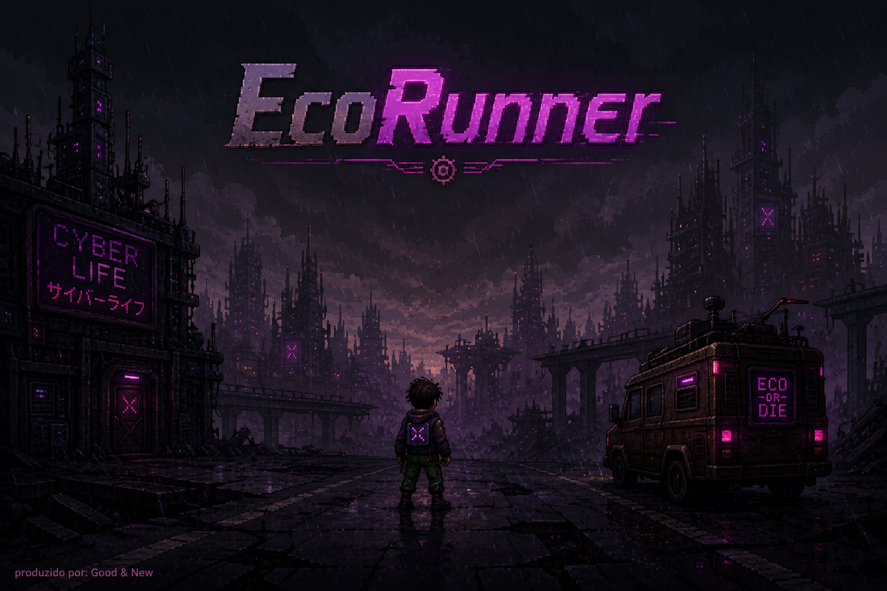

# EcoRunner

EcoRunner e um jogo 2D desenvolvido em Unity/C# que mistura endless runner, progressao por upgrades, coleta de recursos e uma mecanica de extracao com retorno a base. O jogador corre por um planeta devastado pela poluicao, precisa explorar o maximo possivel, coletar recursos e voltar antes que o ambiente toxico o alcance.

Ao retornar vivo para a base, os recursos coletados sao armazenados e podem ser usados para melhorar o personagem ou construir um foguete. O objetivo final e preparar o foguete, realizar um lancamento preciso e escapar do planeta.

## Preview

> Adicione aqui um GIF ou video curto de gameplay.

## Ideia Do Jogo

O mundo de EcoRunner ja foi destruido pela poluicao. O personagem precisa sair da base, correr por areas perigosas, coletar moedas e materiais de construcao, e retornar antes que o tempo acabe.

Se o jogador morrer ou nao voltar para a base, perde os recursos coletados naquela corrida. Essa estrutura cria uma decisao constante de risco e recompensa: avancar mais para coletar mais, ou retornar antes que seja tarde.

## Mecânicas Principais

- Corrida 2D com aceleracao progressiva.
- Salto, salto duplo e dash desbloqueaveis por upgrades.
- Mudanca de direcao durante a corrida para retornar a base.
- Timer toxico que pressiona o jogador a voltar.
- Geracao procedural de plataformas baseada na distancia de salto possivel.
- Obstaculos com animacao de destruicao e perda de velocidade ao colidir.
- Sistema de loja com upgrades permanentes.
- Coleta de moedas e materiais somente ao retornar vivo para a base.
- Construcao de foguete por niveis.
- Lancamento de foguete com desafio de precisao.
- Final narrativo ao atingir a altura necessaria com o foguete completo.

## Upgrades

O jogo possui melhorias compraveis com moedas:

- **Velocidade:** aumenta a velocidade maxima do jogador.
- **Aceleracao:** faz o jogador atingir a velocidade maxima mais rapido.
- **Salto:** aumenta a altura do salto.
- **Resistencia:** reduz a penalidade de velocidade ao colidir com obstaculos e aumenta o tempo de corrida.
- **Dash:** desbloqueia um avanco rapido.
- **Salto duplo:** permite um segundo salto no ar.
- **Multiplicador de moedas:** aumenta a quantidade de moedas recebidas.

## Foguete

O foguete e construido em etapas usando moedas e materiais de construcao. Cada nivel libera uma versao maior do foguete e adiciona uma nova propulsao ao lancamento.

Durante o lancamento, o jogador precisa acertar uma mecanica de precisao com circulos alinhados. A qualidade de cada acerto influencia a forca da propulsao:

- Pessimo
- Bom
- Otimo
- Perfeito

Apenas o foguete de nivel maximo, com boas propulsoes, consegue atingir a altura necessaria para escapar.

## Controles

- **Espaco:** pular.
- **Espaco no ar:** salto duplo, se desbloqueado.
- **Shift:** dash, se desbloqueado.
- **A:** mudar direcao para a esquerda.
- **D:** mudar direcao para a direita.
- **2:** acionar a precisao da propulsao do foguete durante o lancamento.

## Sistemas Técnicos

### Player

O script `Player.cs` controla movimento, velocidade, aceleracao, salto, dash, colisao, retorno a base, timer toxico e aplicacao dos upgrades.

### Geração De Chão

O script `Ground.cs` mantem uma fila de plataformas e gera novos grounds a frente quando necessario. A distancia entre plataformas e calculada com base na capacidade atual de salto e velocidade do jogador, reduzindo a chance de criar saltos impossiveis.

### Obstáculos

O script `Obstacle.cs` controla animacao, collider e destruicao dos obstaculos. Ao colidir, o jogador perde velocidade e o obstaculo toca sua animacao de impacto.

### Animações

O script `PlayerSpriteAnimator.cs` controla os estados visuais do personagem:

- Andando
- Correndo
- Saltando
- Salto no ar
- Dash
- Colisao
- Morte

### UI E Progressão

O script `UIcontroller.cs` controla menu inicial, loja, resultado da corrida, moedas, materiais, upgrades, tela do foguete e tela final.

### Foguete

Os scripts `RocketController.cs` e `RocketFlight.cs` controlam construcao, exibicao dos niveis, mecanica de precisao, fisica do lancamento, propulsoes e final do jogo.

## Tecnologias

- Unity `6000.4.6f1`
- C#
- Unity 2D
- Unity UI
- Physics2D

## Como Abrir O Projeto

1. Clone ou baixe este repositorio.
2. Abra o projeto no Unity Hub.
3. Use a versao Unity `6000.4.6f1` ou uma versao compativel.
4. Abra a cena principal em `Assets/Scenes/GameScene.unity`.
5. Pressione Play.

## Status

Projeto em fase avancada de desenvolvimento. As principais mecanicas ja estao implementadas, incluindo corrida, loja, upgrades, coleta, retorno a base, construcao de foguete, lancamento e final narrativo.

## Autor

Desenvolvido por Kaique.

